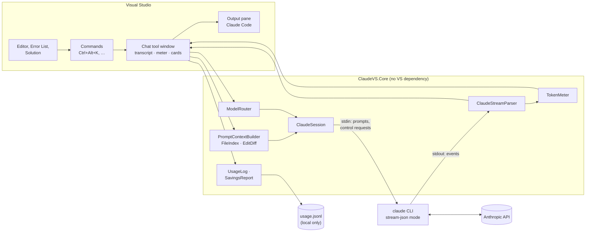
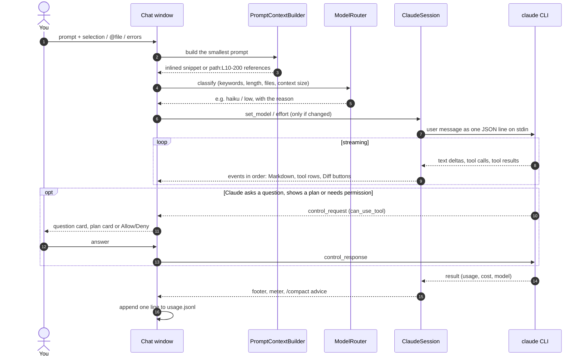
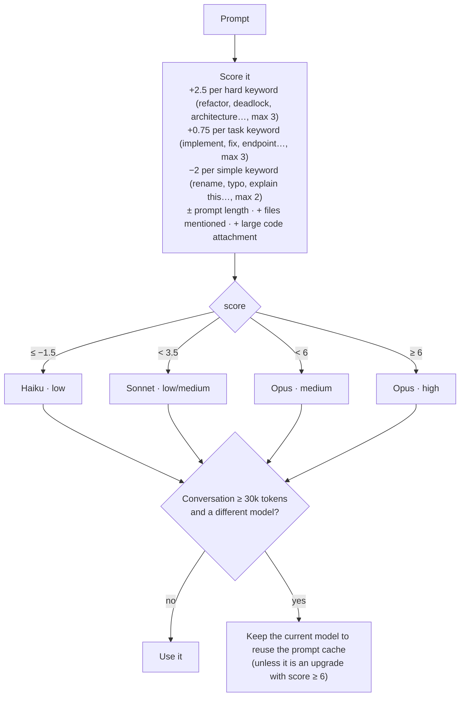

# claude-vs-tokensaver

**Claude Code for Visual Studio — Token Saver**

[](https://github.com/dejanciev-dev/claude-vs-tokensaver/actions/workflows/build.yml)


Claude Code inside Visual Studio 2022 and 2026, built around **spending fewer tokens**. It picks the cheapest
model likely to handle each prompt, sends file *references* instead of file contents, keeps the prompt cache
warm, and shows what every turn costs.

> Community project, not affiliated with or endorsed by Anthropic. "Claude" and "Claude Code" are trademarks of Anthropic.

## Contents

- [Status](#status)
- [Why this exists](#why-this-exists)
- [Features](#features)
- [How it works](#how-it-works)
- [Install and first run](#install-and-first-run)
- [Commands and shortcuts](#commands-and-shortcuts)
- [Settings](#settings)
- [Privacy: what stays on your machine](#privacy-what-stays-on-your-machine)
- [Project layout](#project-layout)
- [Building and testing](#building-and-testing)
- [Known limitations](#known-limitations)
- [Contributing, changelog and license](#contributing-changelog-and-license)

## Status

Pre-release (v0.1 → v0.2).

| Layer | State |
|---|---|
| Core library (CLI session, parser, router, meter, context, Markdown, usage log) | ✅ 157 automated tests, many replaying real CLI output (2.1.316–2.1.322) |
| Core against the real `claude` CLI | ✅ Verified with Claude Code 2.1.322 via the opt-in live tests: streaming, usage, cost, prompt cache, model switch, resume, `/compact`, dialogs, edit review, MCP, question and plan approval. Needs 2.1.318 or newer |
| Visual Studio extension (UI) | ⚠️ Builds with zero warnings in CI, but not yet run in the experimental instance |

## Why this exists

Claude Code is billed by tokens, and most tokens in a coding session are not your question. They come from
three places:

1. **Context.** Every request re-sends the conversation, files Claude has read, tool output and `CLAUDE.md`.
   Pasting a whole file "for context" is paid on every later turn too.
2. **Model choice.** Haiku is far cheaper than Opus, but most extensions use one model for everything.
   A short real turn measured with this extension cost **$0.002 on Haiku vs $0.042 on Sonnet**.
3. **Output.** Output tokens cost about 5× input tokens, so long explanations and restated code add up quickly.

This extension attacks all three, and shows the numbers so you can see the effect.

## Features

### Spend fewer tokens

| Feature | What it does |
|---|---|
| **Auto model and effort routing** | A local classifier (no API call) sends simple prompts to Haiku, normal work to Sonnet, and only hard ones (refactor, deadlock, architecture…) to Opus. The hint under the prompt box shows the choice and the reason before you send. |
| **Route with Haiku** (optional, off) | Instead of the local keyword rules, a small Haiku call picks model and effort for each Auto prompt, with a short reason: about $0.0001 and 1–2 s per prompt. It runs in a separate, trimmed Claude Code process (no tools, no project files, ~1.3k tokens instead of ~25k), started when the chat opens because it takes ~14 s to start. No answer within 4 s: the local rules decide. The savings report shows how often both agree and what the router cost. |
| **Cache-aware routing** | The prompt cache is per model. Once a conversation is large (30k tokens by default), routing never switches to a cheaper model, because re-caching the whole context would cost more than it saves. |
| **Smart selection context** | Small selections are inlined and dedented. Large ones are sent as `path:L10-200` references, so Claude reads only that range. Whole files are never pasted. |
| **File references** | **Attach Current File** and the **`@` file picker** send only a path. Claude reads what it needs. |
| **Compact error list** | **Attach Error List** sends errors only (no warnings), one `file:line` + message line each, de-duplicated and capped at 20. |
| **Claude reads the Error List itself** | A read-only `get_error_list` tool (an MCP server inside the extension) lets Claude check errors and warnings after an edit instead of running a verbose full build. One line per row, errors first; its listing costs almost nothing until Claude uses it. |
| **One warm process per chat** | The `claude` process stays alive between prompts, so the prompt cache is reused (verified: 18k cache-read tokens on the second turn). Model and effort switch live without a restart. |
| **Concise answers** | A one-line system prompt asks for short answers and only the changed code. |
| **Lean `CLAUDE.md` generator** | Writes a short `CLAUDE.md` (projects, build/test commands, folders to skip) and shows its token cost per request. It never overwrites yours. |
| **Token-saving settings and hooks** | Merges into `.claude/settings.json`: blocks reading `bin/obj/node_modules/packages/dist`, caps shell output (`bashOutputMaxChars`), and adds a hook (Bash and PowerShell) that rewrites `dotnet build/test`, `msbuild`, `git log` and `npm test` into their quiet forms. |

### See what you spend

| Feature | What it does |
|---|---|
| **Activity strip** | While Claude works, a strip above the input box shows what it is doing, like the terminal: `✻ Imagining… (1m 05s · ↓ 9.5k tokens · thinking)`, then *Writing…*, *Running… dotnet test*, *Editing…*, *Waiting for you*, colored by phase, with a tip underneath. Once Claude stops thinking, it says for how long (`· thought for 4s`). |
| **Live token meter** | Context fill %, session tokens and cost, cache-hit rate and the current model, colored: context green / amber / red at the /compact thresholds, cache hits green when high. Suggests `/compact` at 60% context and urges it at 85%. Click it for a breakdown of what fills the context (system prompt, tools, memory files, tool results…), from the CLI with no model call. Its tooltip also says what the prompt cache saved in the conversation. |
| **Next prompt's price** | While you type, the line under the input box says what sending costs in input: `~$0.02 to send (context cached)`, or `~$0.25 to send (cache expired: ~100.0k tokens of context at the full price)`, or that another model has no cache for this conversation yet. Output and tool calls come on top. |
| **Per-turn footer** | `✓ 3.1s · 12.4k tok · $0.004 · claude-haiku-5-5`, showing what subagents cost of it (`$0.020 ($0.012 agents)`), the model that *actually* answered, its thinking tokens (`· 1.2k thinking`), how much input came from the cache and what that saved (`· 94% cached (saved $0.018)`), and how many subagents the turn started and what they used (`· 2 agents (31.0k tok)`); refused or failed subagents are pointed out. |
| **Sign-in expiry notice** | From 10 days before your claude.ai sign-in ends: `⚠ Your Claude sign-in ends in 4 days (Nov 21). Sign in` under the meter, red once it has expired. **Sign in** opens a console running `claude auth login`. API-key users never see it. |
| **Model mismatch warning** | If the CLI answers with a different model than the one requested (for example in plan mode), the chat tells you. |
| **Cache-break note** | When the prompt cache is written again while still warm, the chat says how many tokens it rebuilt, what that cost more than reading them, and the likely cause: a model change (each model has its own cache) or a change at the start of the conversation (CLAUDE.md, MCP tools, settings). Once per conversation. |
| **Agents panel** | Claude's subagents and background commands above the input box, as a tree: what each is doing, its tokens, what it cost (API prices), tool calls and time, and its result. **Background** lets Claude carry on while an agent works; **Stop** ends one agent (and what it started) without stopping Claude. A subagent's own tool calls are marked `↳` in the conversation, and its Agent call says what it used and on which model once it finishes. Forks (subagents that start with a copy of the conversation) show as `● Fork(…)`. |
| **Tool rows with sizes** | Tool calls read like the terminal: `● Update(src/a.cs)` with a `⎿ Added 13 lines` line, `● Read(big.txt)` with `⎿ Read 20 of 301 lines (from line 10)`, `● Bash(dotnet test)` with the first lines of its output. Each row shows the size of its result in tokens; results of 5k+ tokens are in bold, because those fill the context. A command or edit your settings let through without asking says so (`· allowed by a rule`), and one they block says `· denied by a rule`. Click a row for its input and whole output. |
| **Savings report** | Actual cost vs the same tokens at Opus prices, tokens saved by references, what the prompt cache saved, what Fable, fast mode and Haiku over 100k tokens cost extra, what subagents cost by kind (Explore, general-purpose, Fork, your own agents), cost per model and per solution, this month so far with a month-end projection, and per day: turns, tokens, cost, cache hits and what the cache saved. |
| **Usage CSV export** | Tools → Claude Code → *Export Usage as CSV…* saves the usage log as a spreadsheet: one row per turn with time, solution, model, routing, tokens (input, output, thinking, cache, fast mode, over 100k, subagents), cost and duration. |
| **Router replay** | With the opt-in prompt preview, the report re-runs your real prompts through the current router rules and lists those that would now route differently. |

### Chat

| Feature | What it does |
|---|---|
| **Markdown answers** | Headings, lists, quotes, inline code and links, rendered while the answer streams. |
| **Code blocks** | **Copy** and **Insert** (at the cursor, one undo step). |
| **Diff for Claude's edits** | Every file change shows up in the chat as numbered red and green lines under its row: Edit / MultiEdit, Write (against the file as it was), and shell commands that write a file (`cat > file <<'EOF'`). Above the lines, **Open diff** opens Visual Studio's diff window and **Open file** the file. |
| **Files changed** | After each answer, a list of the files it added, changed or deleted, with `+added −removed`. Click a path to open the file, or **Diff** for the file before the answer against now. |
| **Review each change** | In Manual mode, an edit or write with several changes asks with a card listing each one (− and + lines) with a check box. **Apply** only the checked ones, **Reject all**, or **Open diff** for the whole file. Claude is told which changes you rejected, so it neither assumes they are in the file nor applies them again. |
| **Question cards** | When Claude asks a question, you get its options (plus "Other") and your answer goes back to Claude. |
| **Plan approval cards** | Plans render as Markdown with **Approve** or **Request changes** (with feedback). |
| **Permission card** | Other tool calls that need approval show a card: the question ("Run this command?"), Claude's description, the command or file, and **Allow**, **Always allow** (the rule Claude Code suggests, saved for this project), **Deny**, or a line telling Claude what to do instead. |
| **Working folder** | Shown under the title: the folder Claude Code runs in (the solution folder by default), which relative paths are based on. Click it to pick another folder (a subfolder or another repository), go back to the solution folder, open it in File Explorer or copy the path. A new folder starts a new conversation. |
| **Sessions** | Resume an earlier conversation for the same solution (`claude --resume`); its earlier prompts, answers and tool calls are redrawn. Each session in the list shows what it cost (`$0.42 · 3h`, at API prices, subagents included), the footer the total, and **Costliest first** sorts by cost. Click the title to rename a session (also passed to the CLI as `--name`); hover a session in the list to rename or archive it. |
| **Images** | Paste a screenshot (`Ctrl+V`) or pick image files with **+ → Upload** and they are sent with the prompt. Thumbnails show above the input box with their token cost (≈ width × height / 750); images are scaled to 1568 px first, since the API would scale larger ones down anyway. |
| **Rewind** | Hover one of your messages → **Rewind** puts the files Claude changed since that prompt back the way they were. You see the list of files first; the conversation stays as it is. |
| **Export** | `/` → *Export conversation…* saves the whole conversation (also what came before a resume or a compaction) as Markdown: your prompts, Claude's answers, and one line per tool call. |
| **Session summary** | `/` → *Copy session summary* copies turns, cost, tokens (input, output, thinking, cache), cache hits and what the cache saved, context and which tools filled it (`Tool results: Read 10.0k · Shell 3.0k`), and what subagents cost by kind (`Subagents by kind: Explore $0.400 · Fork $0.030`) as plain text. |
| **Bookmarks** | Star any answer to keep it. The bookmarks panel lists them per solution with search; clicking one scrolls to it, or shows the saved copy if it came from another conversation. |
| **Claude Code dialogs** | `/` → *Claude Code*: **Status**, **Account & usage** (plan, every usage limit with its reset time, this session's cost), **Memory & instructions** (CLAUDE.md files and saved memories, with what each costs per request; click to open or create), **Output style** (switch for this project), **Permission rules** and **Hooks** (with the settings file each comes from). Read from Claude Code with no model call. |
| **Screen readers** | Announcements through a UIA live region when Claude finishes (with the start of the answer), asks for permission, has a question or a plan, wants an edit reviewed, stops responding, or hits a usage limit. **Focus last message** (`Ctrl+Alt+K, M`) puts the keyboard at the start of Claude's last answer; `Esc` returns to the prompt box. |
| **Several chat windows** | Each window has its own conversation, meter and model. |
| **Prompt box helpers** | `Ctrl+Up/Down` prompt history; typing `/` opens a list of commands above the box (`/compact` and your own `.claude/commands`), each with what it does; Tab or Enter puts it in the box for its arguments. Your skills (project, user and plugin skills, as Claude Code reports them) are in the `/` button menu under Skills; `@` picks a file (each with its size in tokens, `~3.2k tok`). |
| **Diagnostics** | An **Output → Claude Code** pane with route decisions, errors and plain-language hints (not logged in, sign-in expired, answer cut off at the output limit, rate limited, context too long…), plus optional raw CLI traffic. If Claude Code is older than 2.1.318, the chat says so once. |

## How it works

### Architecture

All logic lives in a Visual Studio-independent library, `ClaudeVS.Core`, which is tested on its own. The
extension is a thin WPF layer on top of it. The real work is done by the official `claude` CLI, which the
extension runs as a child process and talks to with JSON lines.



### Life of one prompt



### How the router decides

The router is a fast, local scoring function, so routing itself never costs tokens.



Keywords match whole words, so "prefix" does not count as "fix". You can override the choice at any time with
the model and effort boxes in the toolbar.

### Talking to the CLI

```
claude --print --input-format stream-json --output-format stream-json --verbose
       --include-partial-messages --permission-prompt-tool stdio
       [--model haiku|sonnet|opus] [--effort low..max] [--permission-mode acceptEdits|plan|…]
       [--resume <session-id>] [--append-system-prompt "…"]
```

- Prompts go to stdin as `{"type":"user","message":{…}}` lines. Interrupt, model switch and effort switch are
  `control_request` lines.
- Tool permissions arrive as `control_request` / `can_use_tool`. Questions are answered by allowing the call
  with `updatedInput` plus an `answers` map. Plans are approved by allowing `ExitPlanMode`, or sent back with
  feedback by denying it.
- Context fill is taken from the **last** request of the turn. The top-level usage sums every request in the
  turn and would overstate it.
- Unknown event types (status lines, rate-limit events…) are ignored, so newer CLI versions keep working.

## Install and first run

Requirements:
- Visual Studio 2022 (17.x) or 2026 (18.x), x64 or ARM64
- [Claude Code](https://claude.com/product/claude-code) **2.1.318 or newer** (tested with 2.1.322), installed and
  logged in, so that `claude` works in a terminal. `claude --version` shows yours; `claude update` updates it.
  Older versions lack control requests the extension uses (Stop for one agent, settings changes, rewind
  checkpoints in headless mode) and resume fixes. On Windows, recent versions also fix tool calls refused on some
  volumes and on exFAT / FAT32 drives (2.1.302, 2.1.317), Grep and Glob hanging (2.1.316), and PowerShell hooks
  failing open (2.1.309, 2.1.310).

There is no Marketplace release yet. Either install the `.vsix` from a
[GitHub release](https://github.com/dejanciev-dev/claude-vs-tokensaver/releases) or from a CI build's
artifacts, or build it yourself (see below).

First run:
1. Open a solution, then **View → Other Windows → Claude Code** (`Ctrl+Alt+K, C`).
2. **Tools → Claude Code → Install Token-Saving Settings and Hooks** (once per solution).
3. **Tools → Claude Code → Generate Lean CLAUDE.md** (once per solution).
4. Select code and press `Ctrl+Alt+K, S`, or type a prompt and press **Enter**.

## Commands and shortcuts

| Command | Where | Shortcut |
|---|---|---|
| Open the chat | View → Other Windows · Tools → Claude Code | `Ctrl+Alt+K, C` |
| New chat window | Tools → Claude Code | `Ctrl+Alt+K, N` |
| Ask Claude about the selection | Editor right-click | `Ctrl+Alt+K, S` |
| Attach current file as a reference | Tools → Claude Code · editor right-click | `Ctrl+Alt+K, F` |
| Attach Error List | Tools → Claude Code | `Ctrl+Alt+K, E` |
| Focus last message (keyboard to Claude's last answer; `Esc` goes back) | Tools → Claude Code · `/` | `Ctrl+Alt+K, M` |
| Show Savings Report | Tools → Claude Code | |
| Export Usage as CSV… | Tools → Claude Code | |
| Generate Lean CLAUDE.md | Tools → Claude Code | |
| Install Token-Saving Settings and Hooks | Tools → Claude Code | |

In the prompt box:

| Key | Action |
|---|---|
| `Enter` / `Shift+Enter` | Send / new line |
| `Ctrl+Up` / `Ctrl+Down` | Previous / next prompt (your unsent text is kept) |
| `@` + name | Pick a solution file to attach (`↑ ↓`, `Enter` or `Tab`, `Esc`) |
| `/` | A list of matching commands above the box (`/compact` and your `.claude/commands/*.md`; skills are in the `/` button menu): ↑ ↓ to choose, Tab or Enter to insert, Esc to close |
| `Esc` | Remove attachments |

Editor commands go to the chat window you used last.

## Settings

**Tools → Options → Claude Code → General**

| Category | Setting | Default | Notes |
|---|---|---|---|
| CLI | Claude executable path | *(auto)* | Finds `claude.exe` / `claude.cmd` automatically. |
| CLI | Permission mode | AcceptEdits | Edits are applied; shell commands ask. In **Plan** mode the CLI answered with Sonnet even when Haiku was requested. |
| Chat | Archive inactive sessions after (days) | 14 | Unused sessions move to the Archived group of the sessions list; 0 = never. |
| Chat | Focus view | Off | Consecutive tool calls collapse into one summary row; also / → Focus view. |
| Chat | Screen reader announcements | On | Narrator, NVDA or JAWS announce finished answers (their start), permission requests, questions, plans, edits to review, stalls and usage limits. Nothing is sent without a screen reader. |
| Chat | Show message timestamps | On | Time above each prompt and at the end of each answer line; a date line where the day changes. |
| CLI | File checkpoints (rewind) | On | Claude Code keeps a copy of each file before Claude changes it, so prompts can be rewound. Applies to new sessions. |
| CLI | No forks | Off | Claude can't start forks (subagents that start with a copy of the whole conversation). Sets `CLAUDE_CODE_FORK_SUBAGENT=0`. Applies to new sessions. |
| CLI | Extra arguments | | Appended to the `claude` command line, e.g. `--add-dir ..\shared`. |
| Token saving | Concise answers | On | One-line brevity prompt. |
| Token saving | Default model | Auto | Auto = route each prompt. Fable (2× the Opus price) is only ever your own pick. |
| Token saving | Route with Haiku | Off | A Haiku call picks model and effort instead of the local rules (~$0.0001, 1–2 s per prompt). |
| Token saving | Inline selection up to (lines) | 60 | Larger selections become references. |
| Token saving | Keep model above context (tokens) | 30000 | Cache-aware routing threshold. |
| Token saving | Suggest / Urge /compact at (%) | 60 / 85 | Meter advice. |
| Token saving | Token tips | On | One-time tips when something costs more than it needs to (large or repeated reads, output floods, heavy MCP tools, cold or rebuilt cache, Haiku near 100k, subagents costing more than Claude itself, a costly fork). Off: Output pane only. |
| Token saving | Warn at conversation cost (USD) | 5 | Said once each time a conversation passes another multiple ($5, $10…). 0 = off. |
| Token saving | Warn at daily cost (USD) | 20 | Said once each time today's spend in Visual Studio, all conversations together, passes another multiple ($20, $40…). Earlier turns today come from the usage log. 0 = off. |
| Token saving | Warn at agent cost (USD) | 0.50 | A subagent's row in the agents panel turns amber once its requests pass this amount, with a screen-reader note, so a runaway agent can be stopped. 0 = off. |
| Token saving | Auto-approve quiet rewrites | Off | Hook installer: run rewritten build/test commands without asking. |
| Token saving | Claude can read the Error List | On | The `get_error_list` tool, for new sessions. |
| Token saving | Max attached errors | 20 | For Attach Error List. |
| Pricing | Opus / Sonnet / Haiku / Fable price | 2026-11 list prices | `input, output, cache write, cache read` in USD per million tokens. Used only for the savings estimate. |
| Diagnostics | Keep local usage log | On | See Privacy. |
| Diagnostics | Log prompt preview (for router tuning) | Off | Stores the first 200 characters of each prompt locally. |
| Diagnostics | Log raw CLI traffic | Off | Every JSON line in Output → Claude Code. Large; for debugging. |

## Privacy: what stays on your machine

- **Prompts and code** go only to the `claude` CLI, which sends them to Anthropic exactly as Claude Code does
  in a terminal. The extension has no server and sends nothing anywhere else. The one exception is that
  unexpected errors in background work are reported through Visual Studio's own fault reporting
  (`FileAndForget`), which follows your VS privacy settings.
- **Usage log**: `%LocalAppData%\claude-vs-tokensaver\usage.jsonl`, one line per turn with the model, tokens,
  cost and route decision. It never leaves your machine, rotates at 5 MB and can be turned off.
- **Prompt preview** (off by default): the first 200 characters of each prompt, stored in that same local log.
- **Token estimate**: `%LocalAppData%\claude-vs-tokensaver\token-estimate.json`, two numbers (characters and tokens
  seen) that keep the learned characters-per-token value across restarts. No prompt text. Local only.
- **Conversation history** is the CLI's own (`~/.claude/projects`). The sessions list only reads it.
- **Session names and archive flags**: `%LocalAppData%\claude-vs-tokensaver\sessions.json`. Local only.
- **Bookmarks**: `%LocalAppData%\claude-vs-tokensaver\bookmarks.json`, the prompt and answer text of each starred answer. Local only.

## Project layout

```
ClaudeVS.sln
src/ClaudeVS.Core/            netstandard2.0, all logic, no Visual Studio dependency
  Cli/        ClaudeSession (process + stream-json), ClaudeStreamParser, ClaudeOptions/ArgsBuilder,
              ClaudeCliLocator, ClaudeErrorHints, InteractiveRequests (questions, plans)
  Tokens/     ModelRouter, TokenMeter, ContextUsage, UsageLog, SavingsReport (+ price table, router replay)
  Context/    PromptContextBuilder, FileIndex (@ picker), EditDiff (Diff button)
  Chat/       PromptHistory, SlashCommands, SessionHistory, SessionTranscript, SessionMeta, ConversationExport, Bookmarks
  Markdown/   MarkdownParser (streaming-tolerant subset)
  Setup/      SolutionScanner, ClaudeMdGenerator, TokenSaverSetup
src/ClaudeVS/                 net472 VSIX: package, commands, tool window, options
  ToolWindow/ ClaudeChatControl, TranscriptView (FlowDocument rendering, cards)
  Commands/   ClaudeCommands, VsContext (DTE: selection, errors, diff, insert)
  Diagnostics/ClaudeOutputPane
tests/ClaudeVS.Core.Tests/    dependency-free test runner, live CLI harness, real-output fixtures
.github/                      CI build, tag-triggered release, Marketplace publish, issue templates
marketplace/                  Marketplace publish manifest, overview page, publish.ps1
docs/PLAN.md                  roadmap and status
```

## Building and testing

Requirements: Visual Studio 2022 17.14+ or 2026 with the **Visual Studio extension development** workload, and
the .NET 8 SDK.

```
dotnet test tests/ClaudeVS.Core.Tests                                   # 35 offline tests
msbuild ClaudeVS.sln /restore /p:Configuration=Release /warnaserror     # → src/ClaudeVS/bin/Release/ClaudeVS.vsix
```

- **Debug in VS:** set **ClaudeVS** as the startup project and press **F5** to open the experimental instance.
- **Live check against your CLI** (opt-in, costs a few cents, never runs in CI):
  `dotnet run --project tests/ClaudeVS.Core.Tests -- --live`. `--live-edit-review` checks a partly applied edit (about $0.005). `--live-dialogs` reads every dialog (no cost). `--live-setup` checks the installed hook and deny rules (about $0.005), `--live-session` the meter, model switching and /compact (about $0.05). `--live-haiku-router` routes four prompts with the Haiku router (about $0.001). `--live-mcp` checks that the CLI connects to the
  Error List server, with no prompt and no cost.
- **CI** builds every push and PR with warnings as errors, runs the tests and uploads the `.vsix`. Pushing a
  `v*` tag creates a draft GitHub Release; publishing it starts the Marketplace upload, after approval.

## Known limitations

- **The VS UI has not been run yet.** Everything builds and the Core is verified against the real CLI, but the
  first F5 session may still turn up UI issues. Please [open an issue](https://github.com/dejanciev-dev/claude-vs-tokensaver/issues).
- **Plan mode ignores Haiku.** With Claude Code 2.1.316 to 2.1.322, plan mode answered with Sonnet even when Haiku
  was requested. So in plan mode Auto picks Sonnet instead of Haiku, and a Haiku you pick by hand shows "Plan mode:
  Sonnet answers" under the input box, priced at Sonnet.
- **Resume** redraws at most the last 300 items (prompts, answers, tool calls) of a conversation. Redrawn tool
  rows have no Diff button.
- **Renaming a running session** shows the new name here at once, but the CLI only records it (`--name`) the next
  time that session's process starts. Archiving is local to this extension; the CLI's own `/resume` still lists the session.
- **Rewind** restores files only; Claude still remembers its edits, so tell it what you rewound. Rewinding a prompt from
  an earlier session (after a resume) has not been verified yet; if the CLI has no checkpoint for it, the chat says so.
- **Write diffs** compare against a copy taken when the tool call arrives. If the CLI writes faster, the diff can look
  empty until the result comes in; with Claude Code 2.1.319 the result carries the CLI's own copy and the diff is redrawn from it.
- The output-trimming hook (`trim-output.ps1`) assumes Windows PowerShell. Claude Code under WSL would need a bash version.
- No Marketplace release yet.

## Contributing, changelog and license

- [CONTRIBUTING.md](CONTRIBUTING.md): setup, where code goes, PR checklist, live tests, releasing
- [CHANGELOG.md](CHANGELOG.md): what changed
- [docs/PLAN.md](docs/PLAN.md): roadmap and status
- Credit: the CLI protocol notes were cross-checked against
  [dliedke/ClaudeCodeExtension](https://github.com/dliedke/ClaudeCodeExtension) (MIT). No code was copied.

MIT. See [LICENSE](LICENSE).
